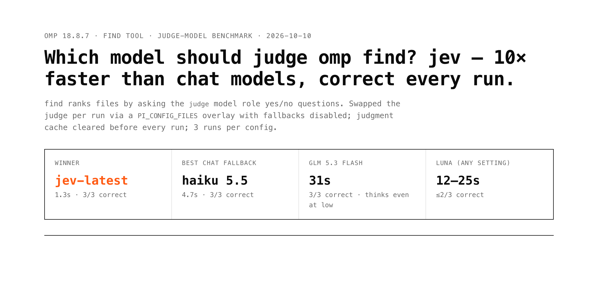
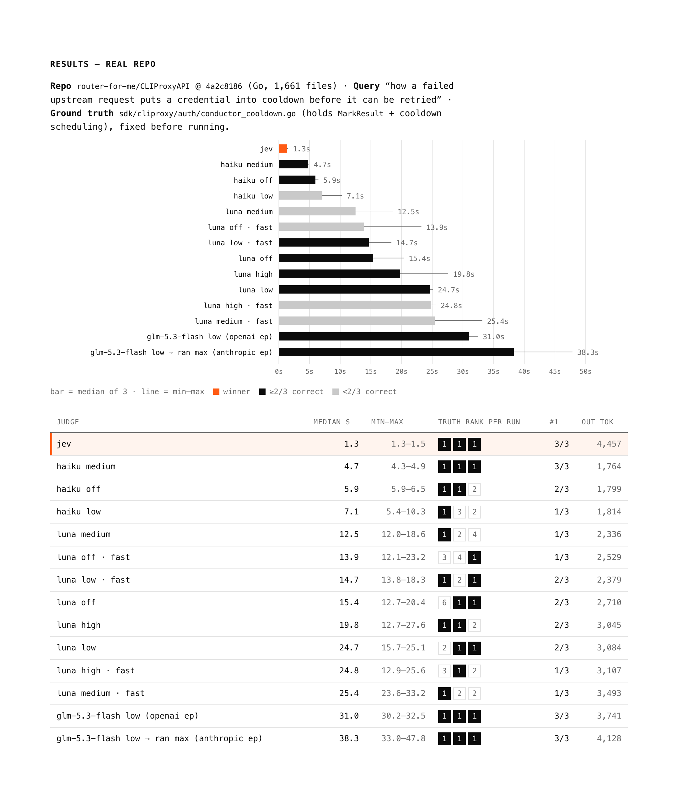

# omp find: which judge model?

[omp](https://github.com/can1357/oh-my-pi)'s `find` tool ranks files by asking the model in the `judge` role yes/no questions about file names and code snippets. This repo benchmarks different judge models on a public Go repo and records what omp actually sends to each provider.

## Findings

1. **`typesafe/jev-latest` was fastest and most consistent:** 1.3 s median, correct file at #1 in 3/3 runs. It's a paid TypeSafe judge model built for find.
2. **`anthropic/claude-haiku-5-5:medium` is the best no-extra-cost option on a Claude subscription:** 4.7 s, 3/3 correct.
3. **Thinking suffixes and fast mode don't reach the provider.** omp's judge sends chat models a request with reasoning disabled and no service tier, so `:low`/`:medium`/`:high` and `tier.openai: priority` have no effect. The differences between Luna rows are run-to-run noise. See [data/wire-capture.json](data/wire-capture.json).
4. **GLM-5.3-Flash on z.ai's Anthropic-compatible endpoint silently runs at max effort.** omp sends `thinking: {type: disabled}`, which GLM-5.3 can't do; z.ai ignores it and uses its default effort. On the OpenAI-compatible endpoint omp sends `reasoning_effort: "low"`, which z.ai honors. Config: [config/zai-glm-5.3-flash.models.yml](config/zai-glm-5.3-flash.models.yml). Draft omp issue: [ISSUE.md](ISSUE.md).
5. **GLM at `low` still takes about 31 s.** GLM-5.3 always thinks; `low` only shrinks the thinking. find asks in three rounds, one after another, and the first round produced 566–857 reasoning tokens per request at about 67 tok/s. omp's in-session find tool stops at 20 s, so GLM as the judge times out on a repo this size.

## Results

`router-for-me/CLIProxyAPI` @ `4a2c8186` (Go, 1,661 files) · 3 runs per config · judgment cache cleared before every run.

| judge | median s | min–max | correct file rank per run | #1 |
|---|---|---|---|---|
| jev-latest | 1.3 | 1.3–1.5 | 1, 1, 1 | 3/3 |
| claude-haiku-5-5 medium | 4.7 | 4.3–4.9 | 1, 1, 1 | 3/3 |
| claude-haiku-5-5 off | 5.9 | 5.9–6.5 | 1, 1, 2 | 2/3 |
| claude-haiku-5-5 low | 7.1 | 5.4–10.3 | 1, 3, 2 | 1/3 |
| gpt-6-luna medium | 12.5 | 12.0–18.6 | 1, 2, 4 | 1/3 |
| gpt-6-luna off · fast | 13.9 | 12.1–23.2 | 3, 4, 1 | 1/3 |
| gpt-6-luna low · fast | 14.7 | 13.8–18.3 | 1, 2, 1 | 2/3 |
| gpt-6-luna off | 15.4 | 12.7–20.4 | 6, 1, 1 | 2/3 |
| gpt-6-luna high | 19.8 | 12.7–27.6 | 1, 1, 2 | 2/3 |
| gpt-6-luna low | 24.7 | 15.7–25.1 | 2, 1, 1 | 2/3 |
| gpt-6-luna high · fast | 24.8 | 12.9–25.6 | 3, 1, 2 | 1/3 |
| gpt-6-luna medium · fast | 25.4 | 23.6–33.2 | 1, 2, 2 | 1/3 |
| glm-5.3-flash low (OpenAI endpoint) | 31.0 | 30.2–32.5 | 1, 1, 1 | 3/3 |
| glm-5.3-flash low → ran max (Anthropic endpoint) | 38.3 | 33.0–47.8 | 1, 1, 1 | 3/3 |

Full report: [report/index.html](report/index.html). More screenshots in [report/](report/).

## Limits

- One query on one repo, 3 runs per config. That's enough to show the request-shape bug, but too small for a model leaderboard.
- Luna ran through the `openai-codex` subscription endpoint and Haiku through the direct Anthropic API, so network and account limits are part of the times.
- `openrouter/z-ai/glm-5.3-flash` is not in the results: every request failed on an account spending limit, which says nothing about the model.

## Reproduce

See [REPRO.md](REPRO.md). [`bench/omp-find-bench`](bench/omp-find-bench) is an interactive version: pick models with fzf, give a query and a directory, and it prints a comparison table.
